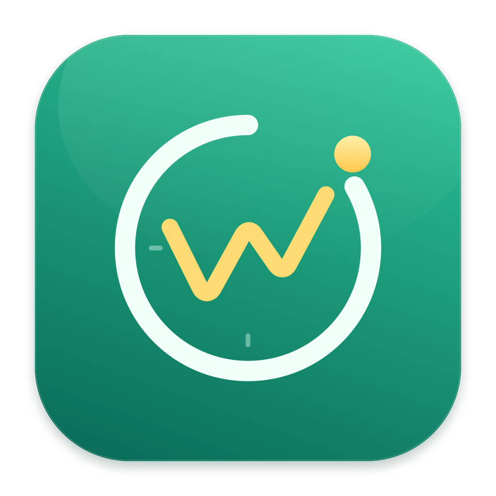

# WageFlow



你的每一秒，都算数

## 功能

- 实时收入、每秒收益动画、上班进度和下班倒计时。
- 月薪 / 日薪 / 时薪，支持午休扣除。
- 自动计薪日历，可手动修改日期、重置并保存。
- 午休时段独立页面，餐碗热气动画与午休结束倒计时。
- 休息日专属看板，咖啡热气和太阳呼吸动画。
- 八种配色（薄荷、落日、鸢尾、海盐、珊瑚、琥珀、樱花、石墨）、金额隐藏及独立桌面看板。

## 预览

实际界面渲染，使用演示数据。

| 工作日 | 午休 |
| --- | --- |
|  |  |

| 休息日 | 薪资计算 |
| --- | --- |
|  |  |

| 外观与隐私 |
| --- |
|  |

<details>
<summary>工作作息与计薪日历</summary>


</details>

## 开发

需要 Swift 5.9+ 和 Apple Command Line Tools。

```sh
swift run WageFlow                  # 启动菜单栏应用
swift run SalaryCoreChecks             # 核心检查
swift build                            # 开发构建
sh scripts/build-app.sh                # 打包至 dist/WageFlow.app
python3 scripts/render-previews.py     # 生成预览图，需要 Python 3
```

点击菜单栏人民币图标打开看板，齿轮进入设置。修改后点击「保存设置」（`⌘S`）生效。

## 计算与日历

月薪按当月计薪天数折算，午休及休息日不累计收入；仅支持当天班次。午休时段看板切换为午休页面并显示结束倒计时，关闭「扣除午休时间」后不显示该页面。

日历使用 [holiday-cn](https://github.com/NateScarlet/holiday-cn)，每月检查更新，GitHub 失败后依次尝试 jsDelivr、Fastly。无可用数据时先按周一至周五计算；获取成功后自动更新，保留手动修改。

薪资和设置仅存本机，联网仅用于获取公开日历。独立看板为普通窗口，不是系统桌面小组件。

## 自动构建与发布

GitHub Actions 在推送 `main`、提交 PR 或手动运行时检查并打包 Apple Silicon / Intel 通用 App，构建附件保留 14 天。

推送 tag 自动创建 Release，附带 App ZIP、SHA-256 校验文件及发布说明：

```sh
git tag v1.0.0
git push origin v1.0.0
```

推荐 `v1.2.0` 格式；含 `-` 的 tag 为预发布。App 版本取 tag 三段数字，其他构建默认 `1.0.0`，构建号取 Actions 运行编号。无需额外发布密钥。

发布失败会自动重试。手动运行工作流时填写 `release_tag`（如 `v0.0.1`），可重新构建并补发已有 tag 的 Release；留空仅构建。

App 使用临时签名，未经过 Apple 公证。确认来源可信后，可通过「系统设置 → 隐私与安全性」允许打开。

## 目录

`Sources/WageFlow/` 界面与系统集成 · `Sources/SalaryCore/` 计算与日历 · `Tests/` 核心检查 · `scripts/` 打包与预览 · `resource/` 图片。
